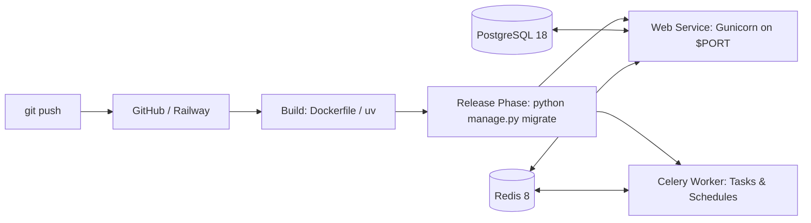

# Railway Automated Deployment Guide

Business OS includes complete automation for deploying to [Railway](https://railway.app/).
Upon git push, the pipeline provisions a PostgreSQL database, a Redis cache/broker, runs migrations, and starts the Django web server + Celery worker.

---

## Architecture Overview



- **Database**: Managed PostgreSQL automatically provisioned via Railway CLI / template. Migrations run automatically during the `release` phase before the application accepts traffic.
- **Cache & Celery Broker**: Managed Redis automatically provisioned via Railway CLI / template. Connected via dynamic reference variable `${{Redis.REDIS_URL}}`.
- **Software**: Containerized multi-stage Python 3.14 build with Gunicorn, Tailwind CSS pre-compiled, and Celery worker.

---

## Quickstart: 1-Command Deployment

### On Linux / macOS / WSL:
```bash
# Make script executable and run:
chmod +x scripts/deploy_railway.sh
./scripts/deploy_railway.sh
```

### On Windows PowerShell:
```powershell
.\scripts\deploy_railway.ps1
```

The script will:
1. Detect or install the Railway CLI (`@railway/cli`).
2. Authenticate using `RAILWAY_TOKEN` or open an interactive login.
3. Create/link the Railway project.
4. Automatically provision PostgreSQL and Redis if not present.
5. Set environment variables (`DJANGO_SETTINGS_MODULE=config.settings.prod`, `SECRET_KEY`, `RUN_MIGRATIONS=true`, `DATABASE_URL`, `REDIS_URL`).
6. Deploy the application container.

---

## Automated Deployment on Git Push

### Option 1: Railway GitHub Integration (Recommended)
1. Open [Railway Dashboard](https://railway.app/dashboard).
2. Create or open your project.
3. Click **New** &rarr; **GitHub Repo** &rarr; Select your `BMS-AV` repository.
4. Railway will automatically detect `railway.json` and `Dockerfile`.
5. Click **+ Add Service** &rarr; **Database** &rarr; **Add PostgreSQL**.
6. Click **+ Add Service** &rarr; **Database** &rarr; **Add Redis**.
7. Railway will automatically build and deploy upon every `git push` to your repository branch.

### Option 2: GitHub Actions Workflow
The repository includes `.github/workflows/railway-deploy.yml`:
1. In Railway, go to **Account Settings** &rarr; **Tokens** &rarr; Create an API Token.
2. In your GitHub repository, go to **Settings** &rarr; **Secrets and variables** &rarr; **Actions**.
3. Add a new secret named `RAILWAY_TOKEN` with your Railway token value.
4. Every push to `main`, `master`, or `feature-v2` will trigger an automated deployment to Railway.

---

## Production Health Checks
Railway probes the `/healthz` endpoint every 15 seconds. If the health check fails, Railway keeps the existing deployment active and rolls back automatically.
